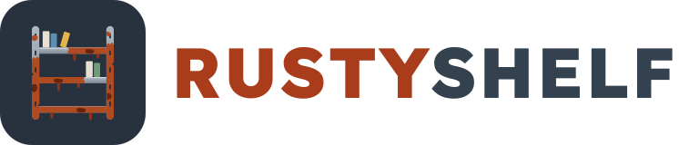

<!-- Based on Boxshelf by sassiestrhihno (https://github.com/sassiestrhihno/boxshelf-source, GPL-3.0): written for RustyShelf
     from Boxshelf's README.md, which documents the features RustyShelf carries over. -->
<h1>
  <picture>
    <source media="(prefers-color-scheme: dark)" srcset="../renderer/brand/rustyshelf-logo-dark.svg">
    
  </picture>
</h1>

This is the full manual. For a short overview, see the [README](../README.md).

**RustyShelf turns your game library into a shelf you browse from the couch.** Emulated console games, Steam and other
PC games, and streaming apps all stand side by side as real boxes on a 3D shelf. Pull one out, open the case, read the
manual, watch the disc go in, and play, all with one controller.

| | |
|---|---|
| **Runs on** | Windows (Electron), Linux (Electron AppImage), Android (Capacitor) |
| **Licence** | [GNU GPL v3.0](../LICENSE) |
| **Downloads** | [Releases page](https://github.com/zearkreast/rustyshelf/releases), once a release is out |
| **Status** | The Electron app is the one to use; a [native Rust version](#native-rust-version) is in progress |

## Where RustyShelf comes from

RustyShelf is a renamed fork of [(T)rustyShelf](https://github.com/GGStonks/t-rustyshelf) by GGStonks. (T)rustyShelf is
in turn a fork of [Boxshelf](https://github.com/sassiestrhihno/boxshelf-beta) by sassiestrhihno, and keeps up with each
Boxshelf beta (currently 1.82.0-beta.10).

Most of what this README describes is Boxshelf's work, by its author. Features that Boxshelf doesn't have, added by the
forks, are tagged **[fork]**. Among them: PC games on Linux without Steam (Windows games through Wine or Proton, your Epic
Games library through legendary, and a folder where every sub-folder is a game), each game's size on the shelf, and a held
Exit button.

> **Want the original Boxshelf?** Download it from the [Boxshelf beta page](https://github.com/sassiestrhihno/boxshelf-beta/releases)
> and report its bugs and ideas in [that project's issues](https://github.com/sassiestrhihno/boxshelf-beta/issues/new/choose),
> not ones about RustyShelf. Boxshelf's [source repository](https://github.com/sassiestrhihno/boxshelf-source) holds a
> snapshot of each beta, starting from 1.82.0-beta.4. The 3D PC model the museum can show is not part of this repository.

**Contents:**
[Install](#install) ·
[Run from source](#run-from-source) ·
[Your folders](#your-folders) ·
[Controls](#controls) ·
[On the shelf](#on-the-shelf) ·
[While a game runs](#while-a-game-runs) ·
[Box art and manuals](#box-art-and-manuals) ·
[PC games](#pc-games) ·
[Settings](#settings) ·
[Extras](#extras) ·
[Privacy](#privacy) ·
[Native Rust version](#native-rust-version) ·
[For developers](#for-developers) ·
[Troubleshooting](#troubleshooting) ·
[Credits and licence](#credits-and-licence)

---

## Install

Grab the newest build from the [releases page](https://github.com/zearkreast/rustyshelf/releases).

**Windows** — `RustyShelf-<version>-windows-portable.exe`
Give it a folder of its own, since it creates its `data` folder next to itself, then double-click it. If Windows warns
about an unknown publisher, choose **More info → Run anyway**.

**Linux** — `RustyShelf-<version>-linux.AppImage` (any distribution: CachyOS, Arch, Fedora, Ubuntu, SteamOS …)
Mark it as executable once (`chmod +x RustyShelf-*-linux.AppImage`, or Properties → *Allow executing as a program*),
then start it. Settings are kept in `~/RustyShelf`. On a Steam Deck in Desktop Mode, RustyShelf offers to add itself to
Steam so you can start it from Game Mode.

If the AppImage doesn't open at all, FUSE 2 is missing. Either install it:

| Distribution | Command |
|---|---|
| Arch / CachyOS | `sudo pacman -S fuse2` |
| Fedora | `sudo dnf install fuse fuse-libs` |
| Ubuntu | `sudo apt install libfuse2t64` |

or run it without FUSE: `./RustyShelf-*-linux.AppImage --appimage-extract-and-run`.

**Android** (AYN Thor and other handhelds) — `RustyShelf-<version>-android.apk`
Open the file on the device and let Android install apps from that source when it asks.

## Run from source

### Windows

1. Install **Node.js LTS** from nodejs.org. This is needed only once.
2. Double-click **Start RustyShelf.bat**. On the first start it installs its dependencies, which takes about a minute.
3. In the setup wizard, click **Find automatically**, look over each system, then click **Open RustyShelf**.

**Start RustyShelf (window).bat** starts it in a window rather than fullscreen. To stop depending on Node, run
`npm run dist` (or double-click **Build RustyShelf.exe.bat**): it builds a portable `RustyShelf.exe` into `dist\`. Keep the
exe in this folder.

The exe is hardened with Electron fuses: it only runs its own packed, integrity-checked app files, and refuses to start as
a plain Node.js runtime or with a debugger attached. It isn't code-signed, so SmartScreen may warn the first time
(**More info → Run anyway**).

### Linux

Install Node.js, npm and `unzip`, then:

```bash
./start-rustyshelf.sh
```

Add `--windowed` for a window, or `--check` to only install what's needed and stop. The first run installs its
dependencies. If npm is interrupted before Electron's download is unpacked, the script finishes unpacking the downloaded
archive with `unzip` rather than downloading it again.

The usual npm commands work too: `npm install`, then `npm start` (or `npm run windowed`). `npm run dist:linux` builds
`dist/RustyShelf-<version>-linux.AppImage`. When there's no `data` folder next to the AppImage, settings go in
`~/RustyShelf`.

## Your folders

RustyShelf is portable on Windows: emulators, games and themes live in folders beside it.

```
RustyShelf\
  Dolphin\       Dolphin.exe             GameCube + Wii
  Cemu\          Cemu.exe                Wii U
  Eden\          eden.exe                Switch
  PPSPP\         PPSSPPWindows64.exe     PSP
  PCSX2\         pcsx2-qt.exe            PS2
  RPCS3\         rpcs3.exe               PS3
  shadPS4\       shadPS4.exe             PS4
  xemu\          xemu.exe                Xbox
  Xenia\         xenia_canary.exe        Xbox 360
  Azahar\        azahar.exe              3DS
  ROMS\Gamecube  ROMS\Wii  ROMS\Wii U  ROMS\Switch  ROMS\PSP  ROMS\PS2  ROMS\PS3  ROMS\PS4  ROMS\Xbox  ROMS\Xbox 360  ROMS\3DS
  themes\<system>\   logo.png · boot.mp4 · console.png | console.glb (+ console.json) · cart.glb | disc.glb | umd.glb
  data\          config.json, rustyshelf.log, caches (art database index, icons, achievements)
```

### How games are found

- Sub-folders are searched too. Folders named `DLC`, `Updates` or `Patches` are skipped, and so are Switch update and DLC
  packages.
- Wii `.nkit.iso` dumps and Switch file names like `[titleid][v0]` get tidied into proper titles.

### Notes per system

| System | What to know |
|---|---|
| **PS4** (shadPS4) | A game is a folder containing `eboot.bin` (e.g. `CUSA00223\eboot.bin`). The title is read from `sce_sys\param.sfo`. |
| **Xbox** (xemu) | Games are `.iso` disc images (XISO). Set up xemu's BIOS, boot ROM and hard disk image first, in xemu under Machine → System. |
| **Xbox 360** (Xenia) | `.iso` discs, extracted folders with a `default.xex`, XBLA `.xex` files, or `.zar` archives. The title ID inside the game gives its real name through Xenia's compatibility list (cached in `data\`), so a `DVD.iso` in a folder still shows the right game, and Details shows Xenia's compatibility rating. Choosing `XeniaManager.exe` is fine: RustyShelf launches the Canary build from its `Emulators` folder. |
| **Wii U** (Cemu) | Point the Wii U page at `Cemu.exe`. Games can be `.wua` files (preferred), `.wud`/`.wux` images (Cemu needs your `keys.txt`), or extracted folders, where `code\*.rpx` is found and the title comes from `meta\meta.xml`. Install updates and DLC inside Cemu. Cemu has no save states, so the Home menu offers Screenshot (F12), Power and Quit. |
| **3DS** (Azahar) | Point the 3DS page at `azahar.exe`. RustyShelf can install unencrypted `.cia` files into Azahar; encrypted ones must be decrypted first. |
| **PS3** (RPCS3) | Launched with `--no-gui --fullscreen`. Install the firmware and your games inside RPCS3 first. |
| **PS Vita** (Vita3K) | Games Vita3K has installed (its `ux0/app` folder, found automatically) are named from their `param.sfo` and started with `-F -r <title id>`. A `.vpk` in a `psvita` folder is handed to Vita3K to install and run. Windows and Linux. |
| **Famicom Disk System** **[fork]** | `.fds` and `.qd` games in an `fds` or `Famicom Disk System` folder, played in RetroArch's NES cores; RetroArch wants `disksys.rom` in its BIOS folder. |
| **Neo Geo Pocket / Color** **[fork]** | `.ngp` games in an `ngp` or `Neo Geo Pocket` folder, `.ngc` games in an `ngpc` or `Neo Geo Pocket Color` folder. Played in RetroArch's Beetle NeoPop core, each with its own box art, manuals and cases, on Android too. |
| **Game.com** **[fork]** | Tiger's handheld: `.tgc` or `.bin` games in a `gamecom` or `Game.com` folder, played in MAME (`mame gamecom -cart1 <game>`). MAME first needs the system file `gamecom.zip` from a MAME BIOS set in its `roms` folder. Windows and Linux. |

## Controls

| Action | Keyboard | Xbox / PlayStation pad |
|---|---|---|
| Move along the shelf | ← → | D-pad / left stick |
| Switch shelf | ↑ ↓ | LT / RT (or D-pad up/down) |
| Jump by letter | Z / C | LB / RB |
| Play / open | Enter | A / Cross |
| Back | Esc | B / Circle |
| Flip the box (front, spine, back; the right stick turns it freely and it settles on a side) | F | Y / Triangle |
| Details | I | X / Square |
| Inspect | V | Right stick click |
| Shuffle to a random game | R | Left stick click |
| Settings · Customize | S · T | Start · Back (short press) |
| Quit a game, or RustyShelf from the shelf | | Hold L3 + R3 (changeable in Settings → Controller) |
| Exit RustyShelf **[fork]**: hold for 3 s while a card fills up, or hold the **Exit** button on the lower bar | Hold X | |

On the shelf, Guide (or Home / P on the keyboard) opens a panel with Home shelf, Museum, Sort, Settings and **Power**:
Sleep, Restart, Shut down and Quit RustyShelf (the last three need A held down). A controller icon next to the clock lights
up while a pad is connected, and the mouse pointer hides while you're using the pad.

## On the shelf

### Inspect

Inspect lifts the box straight out of the shelf, which stays visible behind it.

- Left/right or the D-pad steps between the sides: front, spine, back, edge. The stick turns the box freely and it settles
  on a side when you let go.
- The triggers zoom. While zoomed, the left stick pans gently and the right stick turns.
- A opens the case; A again takes the disc or cartridge out, and the case slides away so you're holding just the disc.
  Hold A to play.
- X reads the manual; turn pages with the bumpers, D-pad, stick or A.
- B puts everything back.

### Details

X (or I) opens Details: the cover, year, genre, players, rating, and your own history with the game (launches, time
played, last played). Below that are a strip of screenshots (flick through with the bumpers or `[` `]`; the chosen one
fills the top), the description, and a **Trailer** button (Y or T) that plays the trailer in a window over the shelf; Esc
or the close button ends it. Hold Y for the achievement list when the game has one.

### Home, Continue and favorites

Once you've played something, a **Home** shelf appears first. It holds your most recently launched games from any system,
followed by your favorites. Hold Y (or press H) on a game to favorite it, and a heart appears on its box. Playing from Home
jumps to the game's own shelf and starts it.

### Sort and filter

G, holding Menu/Start, or the Sort button opens *Arrange your shelves*:

- **Sort by** A–Z, release year, last played, most played, rating or genre.
- **Show** all games, favorites, played, or not played yet. **[fork]** When some games are greyed out (such as an Epic
  game that isn't installed), there's also **Installed**, to show only what you can play right now.

The choice applies to every shelf and the museum, and is remembered. L1/R1 (Z/C) then jump between sections (letters,
years, genres or play-time bands), and in the museum a brass tab on the shelf edge marks where each section begins.

### Museum

Press M, use the **Museum** button, or hold View/Back to see your whole collection as one wall of shelves. Each system gets
a row with every case standing spine-out at its real size, a plaque with that shelf's numbers, and the console at the end:
your own `themes\<system>\console.glb` if you've added one, otherwise an original stand-in. The cases drop into place as
you walk in (any button skips this), and games added since your last visit glow.

- Up/down chooses a row and left/right a case, which slides out and turns toward you with a small card underneath. The
  bumpers skip ten at a time.
- A opens the case in Inspect. A on the console picks it up so you can turn it with the stick. B goes back.
- **Lighting**: Gallery (warm picture lights), Daylight, After hours (a dim room and a strong spotlight) or Neon (each row
  lit in its console's colour). Cycle with Y on the pad or L on the keyboard, or choose one in Settings → Display → Museum.
  The selected case gets its own soft spotlight, and its card shows maker, year, publisher, genre, rating and your play
  history.
- If the museum stutters on your GPU, Settings → Display has a shadows toggle.

### Rooms

Organization is a setting of its own (Room menu in the museum or Settings → RustyShelf → Museum → Organization).
The **Classic wall** above stays available; new installs default to **Rooms by maker**:

- **By maker**: Nintendo, Sony, Sega, Microsoft, Atari and Other (TurboGrafx-16, Neo Geo, WonderSwan, Game.com and
  anything the launcher meets later) each get a room, plus a dedicated **Arcade** wing (cabinets, grouped by genre)
  and a **Computers** room (DOS, PC programs, the Custom shelf). A room holds at most 1,200 games on at most 30 shelf
  segments (40 cases each, one source system per segment) over three walls — sized so one platform's whole collection
  (Xbox 360 alone: 1,000+ titles) fits a single room; only a bigger one continues into another room of the same maker,
  and a system is never split across rooms that could hold it whole.
- **By genre**: one room per primary genre (from each game's LaunchBox details), with Arcade and Computers as their own
  categories and everything without a genre in *Unknown*. Each genre room keeps one shelf segment per source system.
- A **Reading & media** room holds the magazine and guide racks (up to 2,000 items on its ledges; the rest keep working
  through search and the fans), the
  movie/TV-show shelves and the Retro TV. The TV lives there: from another room, "Choose what's on" walks you there,
  and B at a room's overview leaves the museum while **L1/R1 (Q/E) or the Rooms… directory** (Room menu → Rooms…, or O
  on the keyboard) walks the rooms. In the overview, ←/→ step between a room's walls (the camera swings round the
  room); nothing but the room you're in is ever built or lit.

Games added since your last visit still arrive as mail — now collection-wide: pending parcels wait in their own room
until you visit it, and unpacking one room never reseals or re-numbers another. When you return from a game you come
back to the same room, shelf and case.

### The Retro TV's body and sound

The TV's body design (Room menu → Retro TV or Settings → Museum → TV) is now its own choice — the deep tube set, a 70s
wood console with dials, or a modern flat panel — independent of the stand. What's playing survives a body, stand, size
or place change and follows you between rooms: leaving the Reading & media room pauses it and coming back picks the
same element and playhead up again. With **Sound from the set** on (default), TV audio is routed through Web Audio: it
stereo-pans and fades with where the set stands in the room. If a browser or stream can't do that, the plain volume
takes over — the same mute, volume and "Only when I'm looking at it" controls apply either way.

### Attract mode and shuffle

Leave the shelf alone for a few minutes and it starts wandering through the boxes and between shelves by itself, with the
HUD faded out. Any button or mouse movement brings it back; Settings → Display turns it off.

Shuffle (R, or click the left stick) flickers across your shelves and lands on a random game with a holographic flash.
Settings → Library & art can keep it to the shelf you're on.

## While a game runs

**Open the Home menu** with **Guide**, or hold **View/Back** for about a second. The game pauses and a panel slides in from
the left: Resume, Save state, Load state, Screenshot, Power, and Quit to shelf (hold A).

- Sleep saves a state first where it can and leaves the game paused. Restart and Shut down close the game properly first.
- The menu works by sending each emulator's default hotkeys, and shows only what that emulator supports:

  | Emulator | Pause / Save / Load / Screenshot hotkeys |
  |---|---|
  | Dolphin | F10 / Shift+F1 / F1 / F9 |
  | PCSX2 | Space / F1 / F3 / F8 |
  | PPSSPP | F2 / F4 / F12 |
  | Eden | F4 / Ctrl+P |

  If you've remapped them, tell RustyShelf under that console in `data\config.json`:
  `"hotkeys": { "pause": "f10", "save": "shift+f1", "load": "f1", "shot": "f9" }`.
- If Guide opens the Xbox Game Bar instead, turn off its controller shortcut (Windows Settings → Gaming → Xbox Game Bar)
  or use the hold.

**Quit to the shelf** by holding the quit combo for about a second. A small helper reads XInput directly, so this works
even while RustyShelf is minimized. Eden's "stop emulation?" question is switched off in its settings before each launch so
the combo closes it cleanly, and anything still open a few seconds later is ended.

**Media apps** can have their fullscreen key pressed for them once their window appears, and can optionally get a mouse
pointer driven by the pad (Settings → Media) for apps without controller support.

**Launch options** for each system are editable in Settings → (system) → Launch options, where `{rom}` stands for the
game file. The defaults:

| Emulator | Command line |
|---|---|
| Dolphin | `-b -C Dolphin.Display.Fullscreen=True -C Dolphin.Interface.ConfirmStop=False -e "{rom}"` |
| Eden | `-f -g "{rom}"` |
| Cemu | `-f -g "{rom}"` |
| PPSSPP | `--fullscreen --pause-menu-exit "{rom}"` |
| PCSX2 | `-fullscreen -nogui -batch -- "{rom}"` |
| RPCS3 | `--no-gui --fullscreen "{rom}"` |
| shadPS4 | `-f true -g "{rom}"` |
| Xenia | `--fullscreen=true "{rom}"` |
| Azahar | `-f "{rom}"` |

*Cover time* keeps RustyShelf's black screen on top while the emulator opens; raise it if the emulator's window flashes
into view. GameCube games can boot through the real startup sequence once you add an IPL to Dolphin (Settings → GameCube
→ Boot sequence).

## Box art and manuals

### Automatic

Settings → **Find artwork & manuals** goes through every selected shelf and shows one list to tick through before anything
is downloaded.

| What | Where it comes from |
|---|---|
| Fronts | libretro thumbnail library, LaunchBox Games Database |
| Backs, spines, disc and cartridge labels | LaunchBox |
| Descriptions, release dates and ratings in Details | LaunchBox |
| Manuals | GamesDatabase.org (PDFs, turned into pages in the background), Internet Archive |
| GameCube and Wii spines LaunchBox lacks | Cut from GameTDB's full cover scans, found by the disc ID in the game file |
| Switch 2 fronts and backs no database has yet | The Super Mario Wiki's box scans |
| Digital-only titles | Fan-made box fronts, or the Steam poster |

Backs prefer English-only scans (UK / Australia) over the trilingual North American ones; tick *Replace existing backs*
once to swap the ones you already have.

With *Fetch box art / manuals automatically* turned on, games that appear after a rescan get their art and manuals in the
background. Both are **off** on a fresh install until you enable them, on the setup wizard's last page or in Settings →
Library & art.

Manuals already in your folders are never deleted, only moved aside: replaced pages go to
`covers\.manual-originals\<game>\<date>\`.

### By hand

Put images named after the game file in a `covers` folder inside the games folder: `Pikmin (USA).png` for the front, plus
`-back`, `-spine`, `-disc` and `-manual-01.jpg …` variants. App and emulator tiles use each program's own icon.

### Art match **[fork]**

A ROM hack, translation or mod has a file name or serial no database knows, so it gets no art. Details → **Art match**
(console games, Windows and Linux) searches that console's games by name in the already-downloaded LaunchBox database and
libretro's list. **Use** ties the game you choose to this one: its box art is fetched again under that name, and the box art
downloads, the Art Studio and Details' game info keep using it. Pictures you picked in the Art Studio stay; the ones it
replaces go to the art folder's backup. **Back to automatic** looks the art up under the game's own name again.

### PC art

Steam only stores a box cover for games you've viewed in its library grid. For the others, RustyShelf fetches the cover,
hero image, release date, developer, genres, Metacritic score and screenshots from Steam's public store (no account or key
needed) and keeps them in `data\steam-art` and `steam-info.json`. Turning off automatic covers in Settings stops this.

**[fork]** Epic games use Epic's own box art. Settings → Box art & manuals → PC games lists every PC game's cover and where
it comes from (your pick, the store's box art, Steam's art, or a generated case); select a game to change it.

## PC games

### Linux, without Steam **[fork]**

Settings → PC games puts every PC game on the PC shelf alongside your Steam games. RustyShelf starts each one itself, with
the Home menu and the quit combo working like in any other game.

- **A PC games folder** where every sub-folder is a game, named after the folder. RustyShelf tells Linux games (an AppRun,
  a start script, an AppImage or a Linux program) from Windows ones, and prefers the game's own program over installers,
  crash reporters and helpers. *Program for each game* picks a different one when a folder holds several.
  - A folder of **your own copies** can stand in for shared ones, for games that keep their saves in their own folder.
  - **Game data folder** gives Linux games a home of their own, so their saves and settings stay separate from yours.
- **Wine and Proton.** Windows games run through the build you choose in Settings, or the best one found: GE-Proton,
  UMU-Proton, Steam's and Lutris' builds, or the system's Wine, through `umu-run` when that's installed. Every game gets its
  own Wine prefix named after it, and the Easy Anti-Cheat and BattlEye runtimes are used when present. A game can keep its
  own build, prefix and variables under `pc.run` in `data/config.json`; its output is written to
  `data/logs/last-pc-game.log`.
- **Epic Games.** *Get legendary* downloads the open-source Epic client and checks it against the checksum GitHub
  publishes; you then sign in on Epic's own page. Every game you own appears on the shelf: installed ones are playable, the
  rest are greyed out and Play offers to install them in the background. The Epic library page installs, updates and
  uninstalls; new games go into the PC games folder unless you pick another.
- **Epic downloads.** Installs and updates run one at a time from a queue saved in `data/epic-downloads.json`. Settings → PC
  games → **Downloads** shows each one's progress, speed and time left, and lets you pause (what's downloaded is kept, and
  Resume continues from there), move up or remove it. The quick menu has an Epic downloads row too. If the shelf gets an
  Epic game's state wrong, Details → **Installation** sets it to installed or not installed by hand.
- **Storage.** Settings → PC games → **Storage** lists every installed PC game with its size, grouped by drive, along with
  each drive's free space. Sizes are the ones already known: Steam's own, or a folder measured in the background.

### Windows **[fork]**

- **Ports & Recomps.** PC ports and recompilations get a shelf of their own. Quiver Launcher's apps under its Ports
  folders (or tagged as a port, recomp or decomp) go there by themselves; a program you added goes there when you choose
  Ports & Recomps as its Platform (Settings → Custom games → the game), and *Port of* names the console it came from,
  whose case it then sits in.
- **HoYoPlay.** Settings → PC games → *Show installed HoYoPlay games* adds Genshin Impact, Honkai: Star Rail, Zenless Zone
  Zero and Honkai Impact 3rd (and their China versions) to the PC shelf. They're found through HoYoPlay's own registry
  entries and started from their own folders.
- **Window mode.** On a PC game (Quiver, GOG, HoYoPlay, the PC games folder, or programs you added), Details → **Window**
  cycles through three modes, saved with the game in `data/config.json`:
  - *The game's own*: no change.
  - **Borderless**: for games without their own fullscreen. Once the window is up, its frame and title bar are removed and
    it fills its screen for as long as it runs, done by a small PowerShell helper that stops with the game.
  - **Windowed**: the game stays a window and the taskbar stays visible.

  Games running as administrator keep their own mode, because Windows doesn't let another program change their window.
- **Administrator rights.** A program that asks for them is started through Windows' own prompt instead of failing to start.

## Settings

Settings is split into pages, with each emulator's page above them:

| Page | What's on it |
|---|---|
| Display | Theme (Spectrum, Midnight, Aurora, Sunset, Gallery or Synthwave), fullscreen, the background behind the shelf (soft blur, or the game's own artwork, sharp), visual effects, museum shadows, attract mode, interface size |
| Sound | Voice, volume, ambient sound, menu music |
| Controller | Button prompts, quit combo, rumble |
| Library & art | Automatic covers, art folder, shuffle scope, rescan |
| Startup & system | *Open app folder* and other system options |

Some highlights:

- **Interface size** (Display) makes everything larger for a TV across the room.
- **Looks** **[fork]** (Display) saves your current look under a name: theme, background, interface size, clock, home
  layout, order, filter, sound and menu music, and the museum's scene. **Apply** restores all of it in one press (the screen
  reloads), and each look can be renamed, updated or deleted. Looks live in `data/config.json`, so Export everything
  includes them.
- **Show game sizes** **[fork]** (Shelf) shows how much space each game takes, under its name and in Details: a console
  game's file, a Steam game's install, or the folder of a PC games folder or Epic game, measured in the background so the
  shelf never waits. Switch 2 build choices name the emulator ("Lichii · build"), and builds that come as AppImages are
  checked for `.nup` support too.

### Sound

Settings → Sound offers six voices (Aero by default), a master volume, and an optional ambient bed that follows the shelf,
with its own level slider (off by default). The speaker icon next to the clock mutes; hover it for a volume slider. On the
keyboard, `-` and `=` nudge the volume.

**Your own music [fork]** (Windows and Linux): put music files in the `Music` folder next to the app (a `Songs` folder works
too). Formats include mp3, ogg, opus, wav, flac, m4a and aac, with sub-folders, up to 500 files. Then choose Settings →
Sound → Menu music → **Your music**. Tracks play one after another and never the same one twice in a row; *Reload music*
reads the folder again.

## Extras

### Phone companion

Settings → Phone companion turns your phone into a remote. On the same Wi-Fi, scan the QR code and enter the PIN; the phone
can then browse your library, start a game on the TV, read a manual, and act as a d-pad and keyboard. How it's secured is
described under [Privacy](#privacy).

### RetroAchievements

In Settings → Achievements, enter your RetroAchievements username and web API key (retroachievements.org → Settings →
Keys). The shelf then shows your points, per-game progress tags, a progress ring and the full achievement list in Details,
plus a recap of what you unlocked when you return from a game.

Achievements themselves are earned in the emulator, so turn RetroAchievements on and log in there too:

- Dolphin: Config → Achievements (GameCube only; Wii has no sets)
- PPSSPP: Settings → Tools → RetroAchievements
- PCSX2: Settings → Achievements

### Your own 3D models

`themes\<system>\console.glb` replaces the built-in console in both the insert animation and the museum. Add one with
Customize → Console → Add 3D model, or **Find a model**, which opens a search for free downloadable models in your browser
and installs the first `.glb` / `.zip` you save to Downloads. RustyShelf doesn't bundle console models, so check each
model's licence.

In the insert animation the console rises in, its lid opens, the disc lands on it, and the lid closes. Wii, PS2, PS4 and
Xbox 360 models take the disc upright through a front slot, and GameCube opens a lid. Loose accessories in the file are
hidden, and the lid is found by name (`lid`, `cover`, `door` …) or by its shape. Fine-tune it with `console.json`:

```json
{ "yaw": 0, "pitch": 0, "roll": 0, "scale": 1, "lift": 0,
  "lid": "Lid_mesh_name", "lidHinge": "back", "lidAxis": "x", "lidAngle": -70,
  "discX": 0, "discZ": 0, "discHeight": 0, "discScale": 1, "hide": "controller|cable", "exposure": 1 }
```

`"slot": "top"|"front"` overrides the slot, and `"museumYaw"` / `"museumScale"` turn or resize the model on the museum shelf
only.

The media in Inspect can be replaced as well: `themes\sw\cart.glb`, `themes\psp\umd.glb`, and `themes\gc\disc.glb`,
`themes\wii\disc.glb` or `themes\ps4\disc.glb`. Files containing several copies of the object are fine: the first copy with
a picture is used, and the game's own cover goes where that picture was. `cart.json`
(`{ "yaw": 0, "pitch": 0, "roll": 0, "scale": 1 }`) adjusts the automatic orientation. Customize → Test replays the insert
animation without launching anything.

## Privacy

RustyShelf has no accounts, ads or telemetry. Everything it saves stays in its own `data\` folder and in the `covers`
folders next to your games.

### When it goes online

| Service | When | What it sends |
|---|---|---|
| libretro thumbnails, LaunchBox Games Database, GameTDB | Art look-ups (automatic only if you turned that on) | Game titles; GameCube & Wii disc IDs |
| Super Mario Wiki | Switch 2 art look-ups the databases have nothing for | Game titles |
| Internet Archive, GamesDatabase.org | Manual look-ups (automatic only if you turned that on) | Game titles |
| Steam store | PC shelf art for games Steam has no cover for | Steam app IDs |
| raw.githubusercontent.com | Xbox 360 shelf: Xenia's compatibility list, weekly | Nothing |
| RetroAchievements | Only if you enter your account | Your username and web API key (https) |
| YouTube (youtube-nocookie.com) | Only when you play a trailer | The video ID |
| SteamGridDB | Only if you enter your own API key (Settings) | Game titles / Steam app IDs and your key |
| ScreenScraper | Only if you enter your own account | The game file's name, size and checksums (CRC/MD5/SHA-1), and your login; never the file itself |
| fanart.tv | Only if you enter your own API key | Movie/show IDs (Stremio / Nuvio shelves) |
| Stremio (cinemeta, metahub) | Stremio / Nuvio shelves | Movie/show IDs |
| Internet Archive | Retro TV commercials, magazines and guides you search for | The search text |
| Sketchfab, Poly Pizza | Only when you press **Find a model** (opens your browser) | The console name |
| Wikimedia Commons | Only when you press **Find a logo** (Customize) | The console name |
| GitHub **[fork]** | Only when you press **Get legendary** | Nothing (downloads legendary's release) |
| Epic Games, through legendary **[fork]** | Only once you sign in: your library, installs, starting a game | Your Epic sign-in (kept by legendary in `data/legendary`) |
| Epic's image CDN **[fork]** | Box art for your Epic games | The picture addresses Epic lists |
| umu database **[fork]** | Starting a Windows game through Proton, once per game | The store and the game's ID, for its protonfixes |

Fonts are bundled, so nothing is loaded from Google.

### Your data

- **API keys and passwords** you enter, including the RetroAchievements key, are stored encrypted for your Windows account.
  After moving the folder to another PC they have to be entered again.
- **The log**, `data\rustyshelf.log`, writes your home folder as `~` and is kept under about 4 MB.
- **The phone companion** is off until you turn it on. It then runs a small web server that answers only private-range
  addresses on your home network. Phones pair with a 6-digit PIN (five wrong tries lock pairing for 10 minutes), and every
  request needs the long random token the phone receives when it pairs. Tokens are stored only as hashes, and pictures are
  served under random IDs, never file paths.

### What it changes outside its folder

- **Emulator settings.** So that Home → Quit closes games cleanly, RustyShelf turns off the "are you sure?" prompts in
  Eden / yuzu, PCSX2 and RPCS3 before a launch. Each file is backed up once as `<file>.rustyshelf-bak`, and Settings →
  Library & art → *Restore emulator settings* puts them back. Dolphin gets borderless fullscreen and no stop prompt on its
  command line for that run only; its settings files aren't touched.
- **Start with Windows**, only if you turn it on: a shortcut in your Startup folder or an entry under `HKCU\…\Run`. Turn it
  off in Settings before deleting the folder.
- **The controller helper.** While a game runs, a small PowerShell helper in `data\padwatch` watches the pad for Guide and
  the quit combo, presses the emulator's own hotkeys for the Home menu, and moves the mouse pointer out of the way. It acts
  only while the game is in front, and exits by itself if RustyShelf closes.

## Native Rust version

RustyShelf is being rewritten as a native app in Rust, in `crates/` (a Cargo workspace built with
[Bevy](https://bevy.org/)). It isn't a replacement yet; install and use the Electron app above.

**What works so far:**

- Reads the same settings as the Electron app (`data\config.json`), so a setup made in either works in both.
- Finds every console's games the same way the Electron app does: one box per game, discs grouped, updates and DLC left out.
  That includes Xbox 360 games named by their title id (disc images, extracted games, Games on Demand and Arcade
  packages), unpacked Switch 2 games, PS4 `.pkg` packages shown as not installed, PS5 games, arcade sets named from the
  FinalBurn Neo list, and the names and pictures in a Batocera / RetroBat `gamelist.xml`.
- Shows them with their box art on the shelf as the Electron app lays it out, one console at a time: the chosen
  game's case forward in the middle, the others in two angled stacks beside it with their spines out, each in its
  console's own case (the Electron app's table of case shapes and colours), under the same plastic shine and glow.
  Behind them is the colour theme's backdrop (Settings → Display → Theme; all eighteen, with what moves in them:
  Spectrum's ribbons and dust, Arcade's stars and mountains, Aurora's curtains and the rest), in the console's
  colour and washed with the chosen cover's (in Spectrum and Classic; Blur makes the softened cover the whole
  backdrop, and Artwork shows the game's own wide art sharp where it has some on disk, else its cover standing
  at the right), the floor mirroring the cases. Custom themes work as in the Electron
  app: each folder in `Custom themes` with a picture named `background` is a theme (with pictures for single
  consoles and a `theme.json`), the same three examples are written the first time, and Settings → Display →
  Make a theme from a picture makes one of a picture of yours. Over them: the console's name in its own lettering, the consoles' tabs, the clock, the chosen game's
  title, and the bar of keys (the keyboard's, or the pad's once a pad is used), all as the Electron app sets them.
  A shelf has the Electron app's own cases among its games: Surprise me (Enter or R lands on a game, Enter again
  plays it), Open with the console's emulator, and Add games on a shelf that has none and at the end of Custom.
  A favourite wears its heart, a game that isn't installed stands in greys, and the shelves keep the order given
  them in the Electron app's Settings.
  A game without box art gets the cover the Electron app draws for it: a scene and a title font picked by its name
  under the console's band, and a back with four small scenes, its description and what Details knows of it.
- Covers a console's game starting with the Electron app's boot slide: the console's own colours and lettering,
  the game's cover and title, what starts it, and a line filling (their moving backgrounds aren't drawn yet).
- Starts a game the way the Electron app does: in its own emulator build when Details gives it one, else its console's,
  else RetroArch with the console's core; with the options the emulator in use takes (a standalone retro emulator,
  Ryujinx, Dolphin's settings for the session, the GameCube startup), the real Xenia behind Xenia Manager, a PS Vita game
  by its title id, an unpacked Switch 2 game in its newest update, and a PS5 game with the Kyty launcher's settings.
- Shows your installed Steam games on a PC shelf, from every Steam library, with Steam's covers (or the cover you chose
  in the Electron app) and your playtime, and starts them through Steam. Steam's tools (Proton, runtimes) stay off it
  unless Settings → PC games says otherwise.
- Puts the other stores' games on the PC shelf too: the Epic Games Launcher's, GOG Galaxy's, Ubisoft Connect's, the EA
  app's, Xbox / Game Pass and HoYoPlay's (on Windows), and every game in the PC games folder. Epic's, Ubisoft's and EA's
  start through their store, an Xbox game as the Windows app it is, the others by their own program.
- Shows the apps Quiver Launcher installed and the programs you added by hand on the Custom shelf, Quiver's ports and
  recompilations on the Ports & Recomps shelf, or on the PC shelf or a console's shelf when you moved them there, and starts them in their own folder (with Windows' administrator prompt
  for a program that asks for it).
- Gives a PC game the cover you chose in the Electron app, else its console box when Settings → PC games → Console box
  art is on, else the store's cover, a picture in the game's own folder, or the cover of the Steam game with the same
  name.
- Shows the Media shelf's apps (Stremio, Nuvio) and starts them.
- Keeps the play history the Electron app keeps (`data\history.json`): a console game's launches and time in it, a PC
  game's or an app's launches. An emulator that closes within five seconds wasn't a play, and the shelf says so.
- Shows the names you gave games in the Electron app (Details → Rename).
- Does what the Electron app does around a launch: Eden and its forks, PCSX2 and RPCS3 stop asking before they close,
  Dolphin's Stop hotkey takes the quit combo from every controller, a 3DS `.cia` is installed into Azahar the first
  time it's played, and on Windows a RetroArch core that's missing is downloaded.
- Fetches what the shelves need by itself, behind the shelf: the Xbox 360 title list (again after a week), the arcade
  names (once), the size of unpacked Switch 2 games and of PC games' folders, and, unless box art downloads are off,
  the covers and store info Steam's own cache doesn't have. With box art downloads on, the other stores' games get
  the art of the Steam game with the same name. The shelf shows all of it as soon as it's in.
- Downloads box art for console games missing a front, a back or a spine, unless box art downloads are off: fronts
  from the libretro thumbnail library, backs, spines and discs from the LaunchBox Games Database (its index is
  downloaded and built once), and where those have none a spine cut from LaunchBox's full box wrap, a spine (GameCube, Wii) or a spine and a back (Switch,
  3DS) cut from GameTDB's full cover scan, or a Switch 2 front or back from the Super Mario Wiki; a Switch or 3DS
  game no source has a cartridge photo of gets one drawn from its front cover. With your own SteamGridDB key, a game
  no source has a front for gets its best-voted poster, replaced by a real scan when a later check finds one. Each game is looked at once a week at most. With
  Settings → Box art → Sharpest scans first (on unless switched off), the sharpest version comes first and a low-res
  picture RustyShelf downloaded is replaced by a clearly sharper one; any other picture that's there is never
  replaced. Both apps keep the same record of which pictures they placed (`data/art-provenance.json`).
- With your own SteamGridDB key (Settings → Accounts, with a check of the key) and box art downloads on, gives PC
  games, ports and recomps that have no cover at all SteamGridDB's best poster, as the Electron app does (their
  titles are sent to SteamGridDB). The key is kept encrypted like the RetroAchievements one, and the lookups are
  kept in the same `data\sgdb-cache.json`.
- Signs in to ScreenScraper with your own account (Settings → Accounts: username, password, a developer login of
  your own if you have one, and a check that shows the lookups left today), kept encrypted like the other keys.
  The lookup itself is the Electron app's (a game matched by its file's checksums, name and size, then by title;
  the account's limits kept to; the same `data\ss-cache.json`), ready for the Art Studio, which is where its
  box scans are offered and isn't in the Rust app yet.

- Sets itself up on the first run: it looks for your emulators, games folders, Steam and the streaming apps, shows the
  consoles it found switched on, and lets you change each one's emulator and games folders before the shelf opens.
- Has Settings (S or F1, or Start on the pad and then Settings; View opens Details): each console's shelf, emulator and games folders, RetroArch, Steam and the
  other stores, the PC games folder, box art downloads and their region, the art library, fullscreen, the quit combo,
  searching again and restoring the emulators' own settings. Everything is saved to `data\config.json` by the rules
  the Electron app's settings go through, so both apps keep reading the same file.
- Takes text from the keyboard or, with a pad, from an on-screen keyboard: each console's launch options and
  emulator options (Settings → the console → Emulator & advanced, which also opens the emulator on its own, holds the
  GameCube startup and Kyty's launcher switch, and the console's own art folder), and the RetroArch core a console
  runs in.
- Has Custom games in Settings: a program added by hand, its name, launch arguments and the shelf it sits on.
  Many can be added at once, as in the Electron app: several programs picked together, or a folder of games
  scanned (one game per folder, its main program picked, helpers left out, folders of categories stepped into,
  the picture in a game's folder taken as its cover), each found game ticked or not before it's added. On
  Windows a Playnite library can be brought over too (experimental): the games added there by hand onto the
  Custom shelf with their covers and favorites, emulated games' folders onto their consoles, and it can all
  be taken off again.
- Sets emulators up for you on Windows, as the Electron app does (Settings → a console → Set up for me, and the
  first run's switch): the controller, the Home menu's hotkeys, one BIOS folder, a graphics preset and no quit
  questions for RetroArch, Dolphin, DuckStation, PCSX2 and PPSSPP, each file backed up first, with Undo. The page
  also shows the console's RetroArch core (and downloads it) and checks its BIOS files.
- Closes a running game with the quit combo (L3 + R3 unless Settings → Controller says otherwise), held for about
  a second: the emulator is asked to close as a click on its X does, and ended if it's still there eight seconds
  later. On Windows the pads are read through XInput while the game is in front, and the combo only counts while the
  game or RustyShelf is; held on the shelf, it closes RustyShelf.
- Follows a Steam, Epic, Ubisoft, EA or Xbox game while it runs (Seamless play, on Windows, as the Electron app does):
  the game's own process is found in its install folder, its playtime is kept, the quit combo closes it (never
  Steam or a store's launcher), and the shelf knows when it has ended. Settings → Display turns it off.
- Keeps a PC game's window the way Details → Window says (for Quiver's, GOG's and HoYoPlay's games, the PC games
  folder's and programs added by hand): borderless takes its frame off and stretches it over its screen while it
  runs, with the Electron app's own helper.
- Plays the interface's sounds, synthesised as the Electron app's are (the same voices, room and limiter, checked
  against renders of the Electron app's own engine): Aero, Melody with its built-in songs, and Music box; each shelf
  in its own key; the five boot sounds. Settings → Sounds has the switch, the volume, the voice and the boot sound.
- Plays the menu music under the shelf (Settings → Sounds → Menu music): Drift, Night and Glow, written as it goes
  like the Electron app's (the same notes for the same seed, in the shelf's key), stepping back for each sound and
  going quiet while a game runs.
- Plays your own music instead (Menu music → Your music): the audio files in the Music folder beside RustyShelf
  (mp3, ogg, wav, flac, m4a; sub-folders too), shuffled, never the same one twice running; a file that can't be
  played is skipped. Opus files aren't played yet.
- Reads the MIDI files in the Songs folder as songs for the Melody voice, as the Electron app does (the top line as
  the tune, the bass under it as the chords), with or without the built-in songs.
- Shows what you're playing on Discord, when Settings → Display has it on with your Discord application id.
- Has the shelf's menu (G, or Menu on the pad): the order of the shelves (A-Z, release year, last played and the rest of
  the Electron app's), which games they show (favorites, unplayed, a genre, a decade …), and the chosen game as a
  favorite. The choices are the Electron app's own, in the same settings.
- Has the Home shelf (the twelve games you played last, then your favorites), the All shelf when Settings → Display
  asks for it, and your collections (Details → Collections puts a game on shelves of your own; Settings →
  Collections renames and deletes them), each game starting as it does on its own shelf.
- Reads RetroAchievements as the Electron app does (Settings → Accounts: the username and web API key, a check
  of the account, and whether each console's emulator is signed in): a game's progress beside its facts on the
  shelf, its achievements in Details, and what was unlocked when a game is come back from. The key is kept as
  the Electron app keeps it, encrypted for this Windows user, so both apps open each other's.
- Shows a Steam game's achievements in Details, read from what Steam keeps on this PC (its `appcache\stats`
  files, for the account last signed in), as the Electron app does: nothing is asked of Steam, and a game never
  started on this PC has none.
- Has the Trophies screen (Settings → Trophies): the whole RetroAchievements account and, with your own Steam Web
  API key (Settings → Accounts, kept encrypted like the other keys, with a check), the Steam achievements of the
  account signed in to Steam on this PC, side by side: every game with how far it is, the last 30 days' unlocks
  with how rare each is, and the mastered games. The lookups are kept where the Electron app keeps them
  (`data\ra`, `data\steam-ach`).
- Lists the room the PC games take (Settings → PC games and apps → Storage): the installed Steam, Epic, GOG,
  HoYoPlay and PC games folder games by drive, the biggest first, with each drive's free space.
- Finds a game (/ or Ctrl+F, or the left stick held): type a part of its title and the matches from every shelf
  are listed as you type, best first, by the Electron app's own rules (capitals, accents and punctuation don't
  matter); with nothing typed, the games played last. Enter takes the shelf to the one chosen.
- Has Details (I, or X on the pad): the game's description, release date, developer, publisher, genre, players,
  rating and score from the box art database (or Steam's store for a Steam game), its file, emulator and playtime,
  with Play, Favorite and Hide from the shelf. Settings → Hidden games shows a hidden game again.
- Exports and imports everything (Settings → System), as the Electron app does and in the same layout, so an
  export made by either app goes into the other: the settings, the downloads (art, manuals, the box art
  database) and the art kept next to your games, into one folder with a manifest. The page says how big the
  export will be, shows the copy as it goes, and can pause or cancel it; exporting into a folder that already
  holds an export copies only what's new or changed. An import replaces files of the same name, keeps the
  settings there were as a backup file, and starts RustyShelf again.
- Tells you the newest release when asked (Settings → System → Check for a new version), comparing versions
  as the Electron app does, and opens its page; nothing is downloaded or installed, and it doesn't ask by
  itself at start yet, since the releases are still the Electron app's.
- Reads a game's manual (Details → Read the manual) when its pages are beside its box art, where the Electron
  app keeps them: the cover on its own, then the pages in pairs like an open booklet, ← → to turn. A PDF manual
  is drawn into pages by the Electron app's rule (1600 pixels across, 80 pages at most, the PDF removed once all
  of it is in pages), with hayro, a PDF renderer written in Rust; one kept as a PDF opens in the PC's own PDF reader.
- Finds manuals as the Electron app does: Details → Find a manual lists what archive.org and GamesDatabase.org
  have for the game (matched and scored by the Electron app's own rules: the right game, the right sequel, the
  right console, a manual and not a guide), and the one picked is saved as pages beside the box art. With
  Settings → Box art → Fetch manuals for new games on, the confident English matches (or what the Electron
  app's Manual Studio set for the console) come in by themselves, forty games a start at most, a game looked at
  again a day after an error and a month after finding nothing, in the same `data\manual-auto.json`. Before
  that search, the console's scan collections on the Internet Archive are used as the Electron app uses them
  (the same matching of a game to a collection's file, the same `data\manual-collections.json`): the sharpest
  manuals there are, also over a manual that's there unless that one is complete and much sharper, the old
  pages moved to `.manual-originals` beside them. A manual scanned open (two pages a picture) is cut into single
  pages, the front cover first. A collection's manual that has no page scans (Microsoft's digital Xbox 360
  manuals) is drawn from its PDF, and a small scan gives way to GamesDatabase's copy when that one, drawn 2600
  pixels across, really holds more detail. Details has the Manual Studio's two switches for a manual that's there: Keep this manual (no
  automatic pass changes it) and Wrong manual (the pages are another game's: they go to `.manual-originals`,
  that copy is never brought again, and the next best takes its place, a collection's first). A console's page
  says which manuals its games get (the best English one, or a language or region), in the Electron app's
  `data\manual-studio.json`. Details → Manual Studio lists every manual found for the game (the one in use, earlier
  ones set aside, the console's collections, GamesDatabase's PDF, archive.org's uploads, each checked and its first
  page fetched), with its language, region, pages, scan quality and whether it's complete, the best for the
  console's choice first by the Electron app's own points; Enter puts one in place, Undo puts the manual before back,
  and Your own PDF… turns a PDF of yours into pages (the file stays where it is). The manual replaced is always kept
  in `.manual-originals`. Repair is still the Electron app's.
- Has the Home menu (Settings → Controller turns it off, or makes it a centred card). Over a running game, Guide
  on the pad (or View held on its own for a second) pauses the game with its emulator's own hotkey and brings
  RustyShelf forward with Resume, Save state, Load state, Screenshot, Power (Sleep, Restart, Shut down) and Quit
  to shelf: only what that emulator can do, by the Electron app's table of hotkeys and the console's own over
  it. What's chosen goes back to the game's window as those hotkeys; Quit, Restart and Shut down need the button
  held. On the shelf, Home or P (or Guide) opens it with the Home shelf, Settings and Power. Unlike the Electron
  app's, it's drawn in RustyShelf's own window in front of the paused game, not over the game's picture, so a
  saved state is confirmed by the emulator's own message.
- Shows the buttons of the controller in hand (Settings → Controller → Button prompts and Confirm button, as in
  the Electron app): Xbox letters, PlayStation shapes or a Switch pad's letters on the hint bar, in Settings and
  in the Home menu, by the pad's maker and model, then its name. With a Switch pad (or when chosen) the right
  face button confirms and the bottom one goes back, on every screen. A pad Windows shows as an Xbox 360 one is
  asked about as the Electron app asks: the real controllers plugged in (USB or Bluetooth) say whether a
  PlayStation or Switch pad is behind Steam Input or DS4Windows.
- Has a first Inspect (V, or the right stick's click): the chosen case comes up off the shelf to be turned
  freely with the arrows or a stick, tipped, flipped to its other side and brought nearer or further; M reads
  its manual, Enter plays it, Escape puts it back. The case doesn't open yet.
- Has the Art Studio's picker (Details → Box art): for a console game's front, back, spine and disc, every
  version LaunchBox, libretro and GameTDB have (from the lists the box art download keeps), on Switch 2 the
  Super Mario Wiki's box, with your own account ScreenScraper's scans and with your own key SteamGridDB's posters
  for the front (only the HD look picks one by itself), for a Switch or 3DS cartridge one drawn from the front cover,
  the picture in use
  and the ones replaced before it, the best for the console's style first by the Electron app's own points
  (authentic, HD, a region, special edition), each shown beside the list as it's highlighted. Enter puts one in
  use: the old picture goes to `replaced` beside it, never deleted, a spine or a back is cut from a full wrap
  where that's what the source has, and the part is kept as chosen (`art.locks`, which the automatic art check
  respects in both apps). Put the earlier picture back undoes it, and A picture of yours puts a PNG, JPEG or
  WebP of your own in (for a spine, also cut from a picture of the whole box opened flat). Downloads are kept in `data\art-cand`, the
  Electron app's own cache. A console's page has its Box art style (Authentic, HD, a region's boxes, Special
  editions), kept as the Electron app keeps it (`art.styles`): the picker puts that look's best first, and the
  automatic art check takes its parts in that look's order and region. Changing a console's style picks its games'
  pictures again in the background, two games at a time, with its progress on that row: every part whose look
  changed, was picked by hand (that pick gives way) or is missing gets the new look's best, a game locked as it is
  is left alone, and the old pictures go to `replaced`. Details → Box art → Complete sets offers a front, back, spine
  and disc that belong together (one region's LaunchBox, GameTDB or ScreenScraper scans, the best of each source for
  a region, or the HD set; a back and spine cut from one scan first), puts all four in or none, and undoes it. The
  Complete sets style (a region's, or HD) gives every unlocked game its set, and a game with none its parts one by one.
- Has the phone companion (Settings → Phone companion): the same page on the phone, served by the same rules as
  the Electron app's server (home-network addresses only, PIN pairing with its lockouts, tokens kept as hashes,
  pictures under random ids) and with the same `data\companion.json`, so a phone paired with one app stays paired
  with the other. The phone's remote is one more controller on every screen, its keyboard types into Find a game
  and Settings' text boxes, and Play starts the game as pressing A on its case would, closing what's open first.
  The PC's address is the adapter its traffic leaves by, or one on a 192.168 network when that's a VPN; the
  Electron app's list of virtual adapters to pass over isn't used.

**Not yet:** the rest of Settings (Artwork's wide art for games whose art is only on the web; adding Microsoft Store apps), the
rest of the Art Studio (backs and spines made by RustyShelf among the versions: the Electron app draws them in its page), the Manual Studio, and opening the case in Inspect (its disc and its manual inside). Android
isn't built: the rewrite goes to Windows first. Choosing a Switch 2 build, hiding the taskbar
while a game runs and the rest of Seamless play (the loading cover, the window mode, Go to desktop) are Electron-only too.

```bash
cargo run -p rustyshelf --release -- --windowed
```

It uses the same folder as the Electron app: next to the program when a `data` folder is there, otherwise `~/RustyShelf`
on Linux. `RUSTYSHELF_ROOT` points it somewhere else.

| Action | Keyboard | Pad |
|---|---|---|
| Choose a game | ← → | D-pad / left stick |
| Jump by letter | Z / C | LB / RB |
| Change console | ↑ / ↓ | LT / RT |
| Play | Enter | A |
| Turn the case round | F | Y |
| Inspect: hold the case up and turn it freely | V | Right stick click |
| Favorite | H | hold Y |
| Details | I | X |
| Sort and filter (the shelf's menu) | G | Menu |
| Settings | S | View |
| Surprise me | R | left stick click |
| Find a game | / | hold the left stick |
| Home menu | Home / P | Guide (over a game: Guide, or hold View) |
| Quit | Esc | |

`cargo test --workspace` runs its tests, which compare its title and folder rules against the Electron app's own answers
(`node scripts/rust-fixtures.js` regenerates those), its sounds and drawn covers against the Electron app's own
(`node scripts/rust-sound-fixtures.js`), its painting of the themes' backdrops against Chromium's
(`node scripts/rust-paint-fixtures.js`), and its Home menu against the Electron app's page
(`node scripts/rust-home-fixtures.js`); the last three need Playwright's Chromium.

## For developers

### Tests

`node scripts/test-all.js` runs every test in parallel, in about 4 minutes: the Node tests, the real app on a virtual
screen, the demo page, and the device test in seven parts. `--changed` runs only what the changes since the last push can
affect and explains why for each file; the full run is for releases. `--list` shows what would run.

### Release builds

Every push to `rustyshelf` triggers **Build/release check** (`.github/workflows/build-release-check.yml`), which decides
what to do from the commit message:

| Commit message contains | Result |
|---|---|
| Nothing special | The check stops; nothing is built |
| `For build` (or `For build 2.12.4`) | Windows, Linux and Android builds run (`build.yml`) and are kept as the run's downloads for 14 days; no release |
| `For version 2.4.15` | The same builds, then a GitHub release `2.4.15.0` (`release.yml`), marked as the latest |

Versions look like `A.B.C.DDDD`, where `DDDD` is the build number of version `A.B.C`. A bare `For build` takes the next
number after the newest released version (`2.12.4.283` → `2.12.4.284`); `For build 2.12.4` the next one of that version.
A `For version` commit fails if that version has already been released. `For build` only counts as a phrase on its own,
followed by a version, punctuation or the end of the line.

`node scripts/push-build.js "Build: what it is"` creates that build commit, pushes it and returns immediately (a build
takes about 3 minutes on GitHub). `--status` shows how the latest runs are going, and the next build push waits only if
one is still running.

### Community report

`node scripts/community-report.js` collects what people around Boxshelf ask for, report and build on GitHub: the issues,
pull requests and discussions of boxshelf-beta and boxshelf-source (with all comments), each fork's commits that aren't in
the original, projects made from Boxshelf that aren't GitHub forks, and other mentions.

It sorts them into bugs, features, changes, removals and questions using keyword rules (no AI), extracts the sentences
where people ask for something, and marks what's new since the last run and what RustyShelf's commits already mention. The
result is `community-report/report.md` (plus `data.json`); `community-report/done.json` is where you mark items done,
skipped or for later. It uses your `gh` sign-in (or `GITHUB_TOKEN`); `--since 2026-11-01`, `--no-forks` and `--no-search`
narrow it down.

## Troubleshooting

- **Something failed?** `data\rustyshelf.log` records launches, downloads, failed matches and renderer errors. Settings →
  Startup & system → *Open app folder* takes you there.
- **The shelf stutters** on a large or high-refresh screen: try Settings → Display → *Visual effects → Smooth*.
- **The museum stutters:** turn off its shadows in Settings → Display.
- **The Linux AppImage won't start:** see the FUSE 2 note under [Install](#install).

## Credits and licence

The credits (box art and manual sources, fonts, libraries, contributors) and the licence are in the
[README](../README.md#credits).
